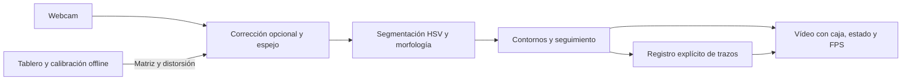

# AirSpell

Primera versión del proyecto de Visión por Ordenador I. Sigue con la webcam un marcador de color en el dedo, dibuja su trayectoria y muestra la caja del marcador, el estado del seguimiento y los FPS. Sirve para probar la captura y registrar los trazos que alimentarán el reconocimiento de letras y hechizos.

## Ejecutar en Windows

Desde la raíz de la asignatura, en una terminal que tenga Conda inicializado:

```powershell
cd .\Proyecto\AirSpell
conda activate voi-lab
python -m pip install -r requirements.txt
python main.py --check-camera
python main.py --show-mask
```

Si no tienes el entorno de las prácticas, puedes crear uno con Python 3.12 de 64 bits. Ejecuta estos comandos desde `Proyecto/AirSpell`:

```powershell
python -m venv .venv
.\.venv\Scripts\python.exe -m pip install -r requirements.txt
.\.venv\Scripts\python.exe main.py --check-camera
.\.venv\Scripts\python.exe main.py --show-mask
```

Coloca en el dedo índice un marcador **verde mate y saturado**. Usa un fondo sin objetos verdes y mira la máscara para asegurarte de que el marcador aparece en blanco. Mantén el foco en la ventana **AirSpell**.

| Control | Acción |
| --- | --- |
| **Espacio** | Pulsa una vez con el marcador visible para iniciar y otra para terminar. |
| **R** | Borra el trazo actual o el último completado. |
| **Q** o **Esc** | Cierra la aplicación. |

Los trazos válidos se quedan dibujados hasta empezar otro o borrarlos. Se descartan los trazos con menos de tres puntos o con una extensión inferior a 25 píxeles. Si el marcador desaparece cinco fotogramas seguidos, se cancela el trazo activo y se busca el marcador en todo el siguiente fotograma. Una pérdida más corta pausa el muestreo. Cuando vuelve el marcador, la línea visual une los puntos medidos antes y después del hueco.

Si el índice por defecto falla, prueba `python main.py --check-camera --camera 1` y, si funciona, usa ese índice también en la ejecución con vídeo. `--check-camera` indica la resolución real y el backend. En Windows se prueba DirectShow y después Media Foundation.

Los valores de HSV están en `config.py` y también pueden ajustarse al lanzar la aplicación. OpenCV usa H entre 0 y 179, y S y V entre 0 y 255. Si aparecen falsos positivos, estrecha el rango. Si el marcador es pequeño, prueba un área mínima menor. Este ejemplo usa un marcador rojo y cubre ambos extremos del tono:

```powershell
python main.py --show-mask --hsv-lower 170 100 70 --hsv-upper 8 255 255 --min-area 80
```

## Calibrar la webcam

1. Prepara un tablero con un número conocido de **esquinas interiores**. Un tablero de 9 × 7 casillas tiene 8 × 6 esquinas interiores.
2. Guarda entre 10 y 20 fotos del tablero en una carpeta, usando la webcam, resolución y configuración de lente que emplearás en AirSpell. Conserva los fotogramas con su orientación original y sin reescalado. Distribuye las poses entre el centro y los bordes, con distintas inclinaciones y distancias. Comprueba que el tablero aparece entero y enfocado.
3. Mide el lado de una casilla. Con un tablero de 8 × 6 esquinas, casillas de 25 mm y fotos en `fotos_tablero`, ejecuta:

```powershell
python -m calibration.calibrate --images .\fotos_tablero --pattern 8 6 --square-size 25
python main.py --calibration .\assets\calibration\webcam.npz --check-camera
python main.py --calibration .\assets\calibration\webcam.npz --show-mask
```

La calibración pinhole se ejecuta offline. Imprime las vistas útiles, la resolución, la matriz intrínseca, la distorsión y el RMS en píxeles. Guarda esos parámetros en `assets/calibration/webcam.npz`. Para repetir el cálculo y conservar el archivo anterior, indica otro nombre con `--output`. Aplica el archivo solo a la cámara con la que se obtuvieron las imágenes. Si la cámara entrega una resolución distinta, AirSpell avisa y termina. Sin `--calibration`, se puede probar el seguimiento con la imagen original.

Las matrices del notebook de la práctica 2 proceden de sus cámaras estéreo y ojo de pez. Los datos estéreo son útiles para verificar el calibrador y se necesita un archivo propio para corregir la webcam.

## Qué se reutilizó de las prácticas

| Material revisado | Aplicación en AirSpell |
| --- | --- |
| Práctica 1, `lab_1.ipynb` y `utils.py` | Adaptados `cvtColor(BGR→HSV)` e `inRange` de `get_hsv_color_ranges`. Los límites se fijan en configuración o desde la terminal. |
| Práctica 2, `lab_2.ipynb`, informe y fotos de los tableros | Adaptados `get_chessboard_points`, `findChessboardCorners`, `cornerSubPix` y `calibrateCamera` del apartado pinhole. La corrección reutiliza la idea de precalcular mapas y aplicar `remap`, con mapas del modelo pinhole. |
| Práctica 3, `partA-B.ipynb` y `utils.py` | Revisados el filtrado, Canny/Sobel, la supresión de máximos, la umbralización y la erosión/dilatación. Se usa apertura y cierre con OpenCV, aprovechando las operaciones morfológicas sobre la máscara. |
| Práctica 4, `partA/B/C.ipynb` y `utils.py` | Harris, Shi–Tomasi, Hough, SIFT y homografía. Hough puede servir para analizar segmentos más adelante. Para un marcador uniforme basta con obtener centroide y caja por contornos. |
| Práctica 5, `partA.ipynb`, `partB-D.ipynb` y módulos de apoyo | El apartado A implementa BoW y SVM para escenas. Los apartados B–D incluyen diferencia de fotogramas, MOG2, flujo óptico Lucas–Kanade y seguimiento con histograma HSV, MeanShift y Kalman. Se recupera el planteamiento de actualizar y mostrar la caja por fotograma. La asociación por proximidad y la media exponencial bastan como punto de partida para el centro de un marcador. |
| Proyecto oficial, `Lab_Project/src/test.py` | Se adapta la lectura continua, el vídeo en espejo, los controles de OpenCV y la liberación de la cámara. |

## Arquitectura y requisitos del proyecto



`main.py` coordina la captura, los controles y la visualización. `calibration/` estima, guarda, carga y aplica los parámetros. En `vision/`, `camera.py` abre el dispositivo, `marker.py` obtiene contornos y sus centroides, `tracker.py` asocia candidatos con el fotograma anterior y `trajectory.py` registra puntos durante un trazo. La caja corresponde a la detección actual y la media exponencial se aplica al centro usado para dibujar.

Según las secciones 3 a 7 de la [guía oficial](../Lab_Project/Lab_Project.pdf), la entrega final incluye calibración offline y RMS, detector de patrones, decodificador de hasta cuatro patrones, tracker tras el desbloqueo y salida en tiempo real. El prototipo ya sirve para validar el detector del marcador, la caja, la recuperación y el vídeo. En la versión final, el bloque de visión será compartido por la escritura y el juego, y el decodificador decidirá cuándo se activa la aplicación propuesta. Queda pendiente la aprobación del profesor para usar letras dibujadas en el aire como patrones y para integrar un juego externo. El informe final tiene un máximo de cinco páginas e incluye el diagrama, las transformaciones, bibliografía y declaración del uso de IA. El vídeo de demostración debe mostrar los FPS.

## Verificación

```powershell
python -m unittest discover -s tests -v
```

Las pruebas usan fotogramas sintéticos y una captura simulada. Cubren la detección de color, el ruido, la caja y el centro, la asociación de candidatos, la pérdida y recuperación, los trazos y la calibración. El calibrador también se ejecutó con las **19 vistas de la cámara izquierda de la práctica 2** a 320 × 240. Detectó el tablero en todas y obtuvo **0,0936 px de RMS**. Se comprobó la recarga del archivo y la corrección de una de aquellas imágenes. Ese dato corresponde a la ejecución sobre las imágenes de la práctica.

En la sesión de ejecución no se recibieron fotogramas de las cámaras 0 y 1. Con la webcam física, comprueba que la caja acompaña al dedo, que al ocultarlo se cancela un trazo y que la caja reaparece cuando vuelve el marcador. Termina un trazo amplio y luego uno corto para comparar el resultado. Anota la resolución, los FPS que ves, la iluminación y los límites HSV que funcionen.

## Siguiente orden de implementación

1. **Reconocer letras de un trazo**. Recoger ejemplos reales de L, V, Z y O. Remuestrear por longitud de arco, centrar y escalar sin deformar la proporción y comparar con plantillas. Medir aciertos y rechazar trazos ambiguos.
2. **Decodificar la contraseña**. Añadir en `security/` una secuencia configurable de una a cuatro letras, estado de bloqueo, borrado y reinicio tras un intento fallido.
3. **Clasificar hechizos e integrar el juego**. Reutilizar en `recognition/` el preprocesado para líneas verticales, horizontales, diagonales, V y otros símbolos que se confirmen. Google describe el juego original como dibujar los símbolos arrastrando. En la siguiente fase habrá que verificar en el lienzo del navegador la secuencia de pulsación, desplazamiento y liberación del botón izquierdo. A partir de esa prueba, `game/` podrá mapear la trayectoria al área jugable y enviarla como arrastre de ratón. Si el entorno bloquea la integración, un lienzo de diagnóstico permitirá comprobar ese mapeo y los gestos. [Magic Cat Academy, Google Doodles](https://doodles.google/doodle/halloween-2016/)
